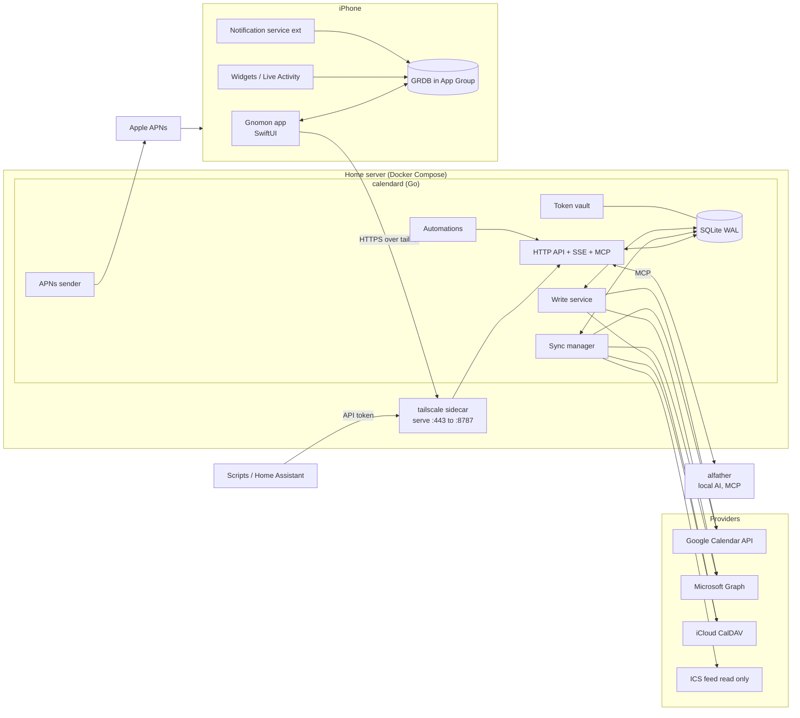
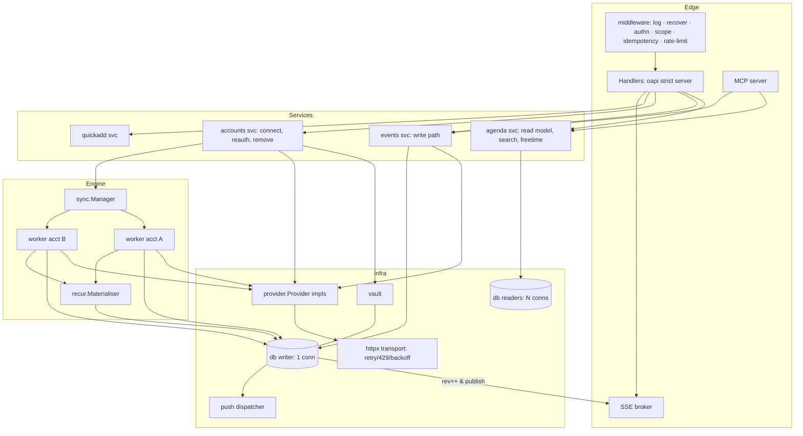
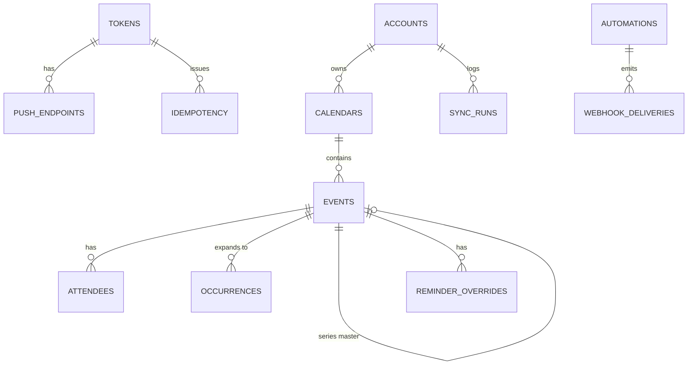
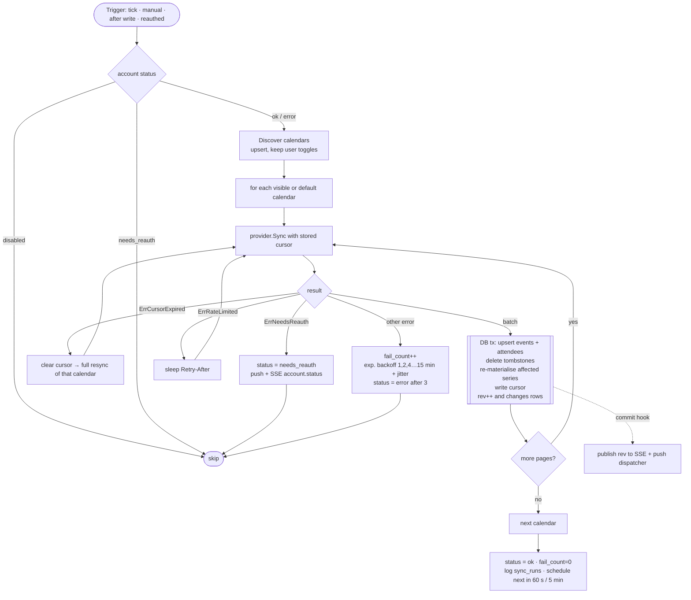
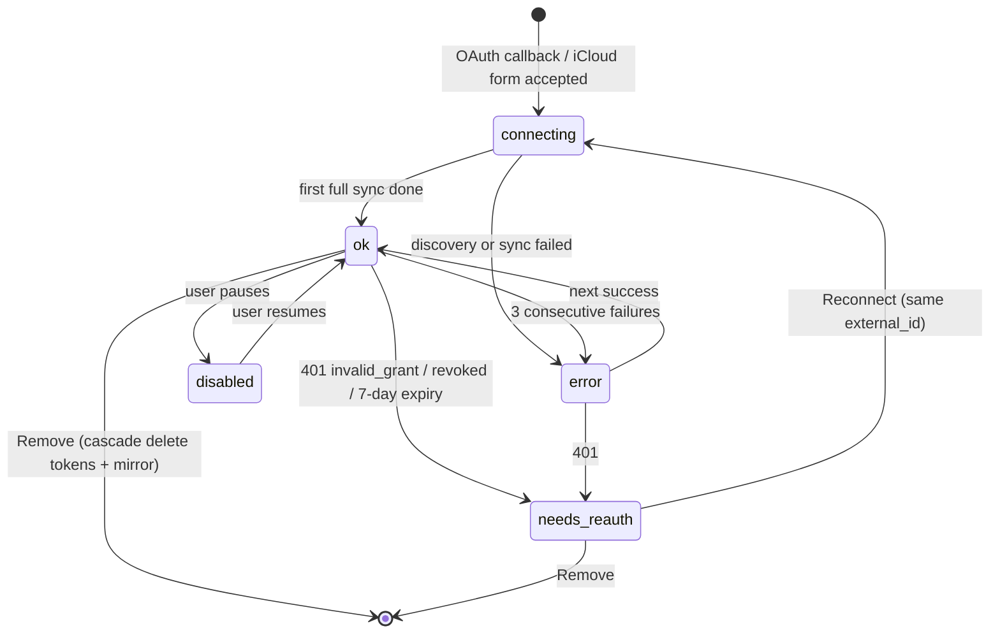
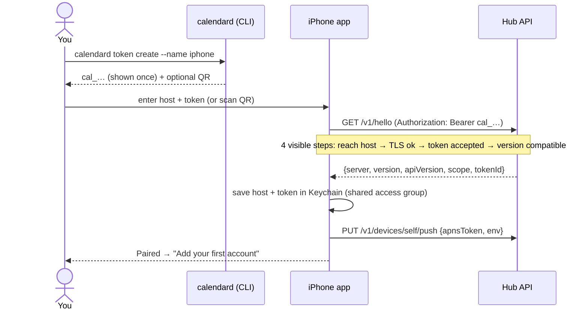
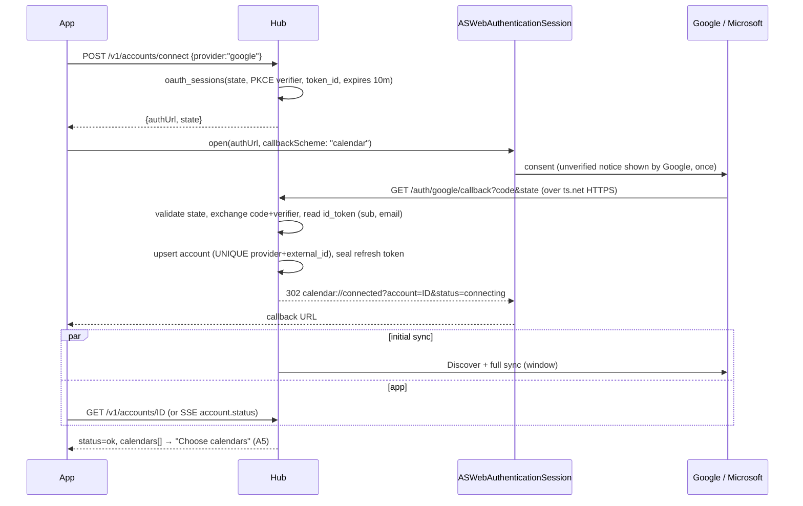
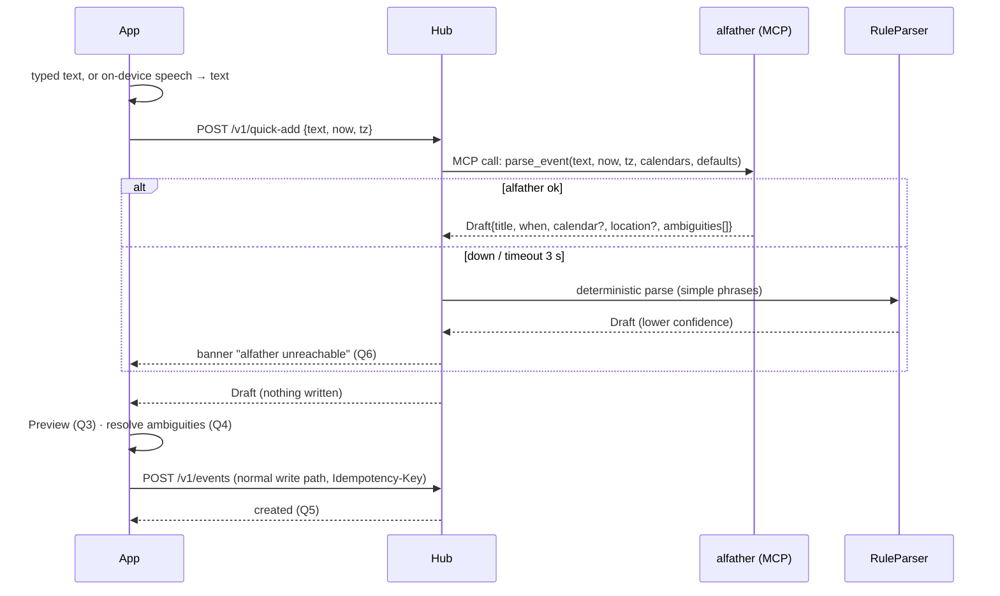
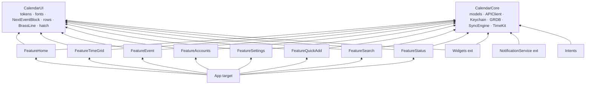
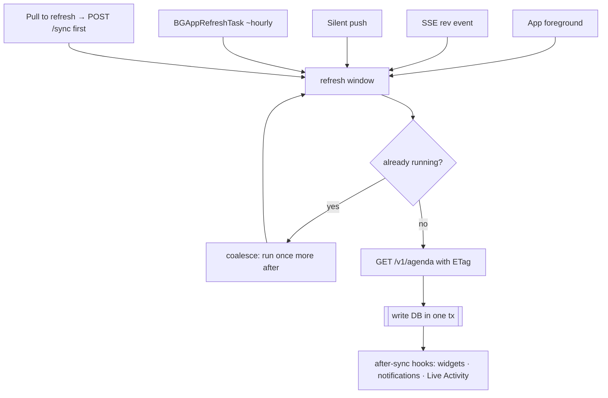

# Gnomon — Engineering Plan

_2026-10-11 · builds on [RESEARCH.md](RESEARCH.md) (rev 3), [PLAN.md](PLAN.md) (stories E0–E8) and the Gnomon design set in [design/](design/README.md)_

**Gnomon** = a Go hub on the home server (`calendard`) + a native SwiftUI iPhone app. The hub owns every provider connection, mirrors all events into SQLite, and exposes one API that the app, scripts and alfather (local AI, via MCP) all use. The phone never holds provider tokens.

> **Names (synced 2026-10-11):** code and config use the shipped identifiers: binary `calendard`, Go module `calendar/server`, token prefix `cal_`, environment `CALENDAR_*`, URL scheme `calendar://`, Swift packages `CalendarCore`/`CalendarUI`. "Gnomon" is only the design set's name (DECISIONS D8).
> **Where the build deviates from this plan:** no code generators and plain `database/sql` instead of sqlc/oapi-codegen (D2, D3); `sqlc diff` in the CI list does not apply; backups are encrypted in-process with a key derived from the master key instead of `age` + cron (DECISIONS section D, entry B4); `calendard pair` (QR) is not built. DECISIONS.md section D is the record of every other choice.

> **This replaces the stack assumptions in PLAN.md** (Expo + TypeScript → **SwiftUI + Go**). User stories and milestones M0–M7 stay as they are. This doc says how to build them.

---

## 0. Decisions at a glance

| Area | Decision | Why |
|---|---|---|
| Server language | **Go 1.23+**, one static binary, `net/http` (1.22 pattern mux) | Simple deploy, great concurrency for per-account sync loops |
| Database | **SQLite (WAL)** via `modernc.org/sqlite` (pure Go, no cgo), `sqlc` queries, `goose` migrations | One file to back up; no cgo makes Docker builds trivial |
| API contract | **OpenAPI 3.1 is the source of truth** → `oapi-codegen` (Go server) + `swift-openapi-generator` (Swift client) | One schema, zero hand-written DTO drift |
| Provider access | Thin hand-written REST clients over `golang.org/x/oauth2` + one shared retrying `http.RoundTripper`; CalDAV via `emersion/go-webdav` + `emersion/go-ical` | Avoids heavy SDKs; uniform backoff/429 handling; easy to fake in tests |
| Recurrence | `teambition/rrule-go` for masters; provider-expanded instances kept as-is (Graph) | See §4.3 |
| Secrets at rest | XChaCha20-Poly1305 sealed blobs, master key from Docker secret | Refresh tokens are the crown jewels |
| Live updates | **SSE** (`/v1/stream`) carrying only a `rev` number; clients re-fetch | Tiny protocol, trivially resumable |
| Remote access | **Tailscale sidecar + `tailscale serve`** (valid `*.ts.net` cert) | Matches OAuth redirect requirement; nothing exposed publicly |
| iOS | **SwiftUI + Observation**, min **iOS 18**, Swift 6 strict concurrency | Widgets, Live Activities, App Intents are first-class |
| Local store (iOS) | **GRDB** (SQLite) in an **App Group** shared by app, widget, notification extension | Widgets read the same DB; `ValueObservation` drives UI |
| iOS structure | Local SwiftPM packages (`CalendarCore`, `CalendarUI`, features) | Fast builds, enforced boundaries |
| Push | **APNs from the hub** (silent + mutable-content, no event text in payload) | Needed for "event moved", Live Activity updates, reliable reminders |
| AI | **alfather over MCP**, both directions; LLM only *parses*, never writes without confirm | Local, private; deterministic fallback |
| Sync (client ↔ hub) | Re-fetch the window with `ETag`/`rev` (no per-entity delta protocol in v1) | A single user has hundreds of rows in view, not millions |
| Offline | Read-only offline in v1 (matches design K1/K2); outbox queue is v1.1 | Avoids conflict UX before the basics are solid |
| Apple program | **Enrol in Apple Developer Program ($99/yr) on day 1** | App Groups, APNs, TestFlight, no 7-day expiry |

---

## 1. System overview



**Trust boundaries:** provider tokens live only in the hub vault. The phone holds one revocable *device token* in the Keychain. The tailnet is the network perimeter; the device token is the application perimeter (defence in depth).

---

## 2. Repository layout (monorepo)

```
calendar/
├─ api/
│  └─ openapi.yaml                 # source of truth for HTTP API (also SSE event schemas)
├─ server/
│  ├─ cmd/calendard/                 # main: serve | token | migrate | backup | restore | rekey | doctor | health
│  ├─ internal/
│  │  ├─ config/                   # env + secrets
│  │  ├─ db/                       # migrations/, queries/ (sqlc), tx helpers, writer/reader pools
│  │  ├─ domain/                   # pure types: Event, When, Attendee… (no I/O)
│  │  ├─ vault/                    # seal/open secrets
│  │  ├─ authn/                    # device/script tokens, middleware, scopes
│  │  ├─ oauth/                    # state, PKCE, google & microsoft flows
│  │  ├─ provider/                 # Provider interface + caps
│  │  │  ├─ google/ microsoft/ icloud/ ics/
│  │  │  └─ httpx/                 # shared retry/backoff/rate-limit transport
│  │  ├─ sync/                     # manager, per-account worker, state machine
│  │  ├─ recur/                    # rrule expansion + occurrence materialiser
│  │  ├─ events/                   # write service (create/patch/delete/rsvp/meet/move)
│  │  ├─ agenda/                   # read queries, freetime, search (FTS5)
│  │  ├─ stream/                   # SSE broker, rev log
│  │  ├─ push/                     # APNs client + dispatcher
│  │  ├─ alfather/                 # MCP client (parse), MCP server (tools)
│  │  ├─ automation/               # triggers → webhook/ntfy
│  │  ├─ tz/                       # Windows→IANA map, DST helpers
│  │  └─ api/                      # generated handlers + hand-written impl
│  └─ testdata/                    # recorded provider payloads, .ics fixtures
├─ ios/
│  ├─ Calendar.xcodeproj
│  ├─ App/                         # @main, scene, DI, deep links
│  ├─ Widgets/                     # WidgetKit + ActivityKit
│  ├─ NotificationService/         # mutable-content extension
│  ├─ Intents/                     # App Intents (Quick add, What's next)
│  └─ Packages/
│     ├─ CalendarCore/               # models, Keychain, API client, GRDB, SyncEngine, Clock/TZ
│     ├─ CalendarUI/                 # tokens, fonts, components (rows, next-event block, brass line)
│     ├─ FeatureHome/ FeatureTimeGrid/ FeatureEvent/ FeatureAccounts/
│     ├─ FeatureSettings/ FeatureQuickAdd/ FeatureSearch/ FeatureStatus/
├─ deploy/
│  ├─ compose.yaml  Dockerfile  calendard.env.example  backup.sh
├─ design/                         # existing hi-fi set (Gnomon)
├─ docs/  ENGINEERING.md  RESEARCH.md  PLAN.md
└─ Makefile                        # make gen | test | run | ios-test | release
```

Generators run from `make gen`: `sqlc generate`, `oapi-codegen`, Swift OpenAPI plugin (build-time), design-token → Swift (`tokens.json` → `Tokens.swift`).

---

## 3. Server architecture (Go)

### 3.1 Components



### 3.2 Concurrency model (the part that bites)

- **One write connection** (`SetMaxOpenConns(1)`, `_txlock=immediate`) + a pool of read connections. SQLite WAL means readers never block on the writer. All mutations go through `db.Write(ctx, func(tx) error)`.
- **One goroutine per account** (`sync.Worker`) with a `chan Trigger` (`Tick | Manual | AfterWrite | Reauthed`). The worker owns that account's sync cursors.
- **Per-account mutex between sync and user writes.** A write holds it for the duration of *provider call → mirror upsert*, so a poll can't clobber a half-applied edit.
- **Rev log.** Every committed transaction that changes user-visible data increments a global `rev` and appends to `changes`; the commit hook publishes `rev` to the SSE broker. Clients that missed events reconnect with `Last-Event-ID` and just compare numbers.
- **Singleflight** on `POST /v1/sync` (manual refresh) per account.
- **Graceful shutdown:** stop accepting requests → cancel workers (cursors are persisted after every page) → close DB.

### 3.3 Config & deployment

```yaml
# deploy/compose.yaml (sketch)
services:
  tailscale:
    image: tailscale/tailscale
    environment: [TS_AUTHKEY_FILE=/run/secrets/ts_key, TS_SERVE_CONFIG=/config/serve.json, TS_STATE_DIR=/var/lib/tailscale]
    volumes: [ts-state:/var/lib/tailscale, ./serve.json:/config/serve.json:ro]
    cap_add: [NET_ADMIN]
    restart: unless-stopped
  calendard:
    build: ../server
    network_mode: service:tailscale      # listens on 127.0.0.1:8787 inside the tailnet node
    environment:
      CALENDAR_PUBLIC_URL: https://calendar.<tailnet>.ts.net
      CALENDAR_DB: /data/calendar.db
    secrets: [master_key, google_client, ms_client, apns_key]
    volumes: [data:/data]
    restart: unless-stopped
    healthcheck: { test: ["CMD","calendard","health"], interval: 30s }
```

- `calendard serve` refuses to start without `master_key` (US-0.4).
- `calendard token create --name iphone --kind device --scope write` prints the secret **once**.
- `calendard pair` (optional) prints a QR with `calendar://pair?host=…&token=…` so you don't type a token on a phone.
- Nightly `backup.sh`: `sqlite3 .backup` + `age`-encrypt → NAS/another disk. The master key is backed up separately; without it the DB's secrets are useless (by design).

---

## 4. Data model

### 4.1 Principles

1. **`events` is the write model** (a faithful mirror of what the provider holds, plus our ids). **`occurrences` is the read model** (one row per thing you can see on a calendar). Agenda, day, week, free-time, widgets and search all read `occurrences`. Nothing in the read path ever expands RRULEs at request time.
2. **Time is explicit.** Timed events: UTC instants + IANA `tzid`. All-day events: civil dates, end exclusive, **no timezone**. Never store all-day as midnight-UTC and hope.
3. **Our ids are ULIDs**, provider ids are columns. Clients never see provider ids.
4. **Soft delete + tombstones** so SSE/`rev` consumers see deletions.

### 4.2 ER diagram



### 4.3 SQLite schema (migration `0001_init.sql`, abridged but complete in shape)

```sql
CREATE TABLE meta (key TEXT PRIMARY KEY, value TEXT NOT NULL);       -- rev, schema_version, instance_id

CREATE TABLE tokens (                                                 -- device + script credentials
  id TEXT PRIMARY KEY,                                                -- ulid
  name TEXT NOT NULL,
  kind TEXT NOT NULL CHECK (kind IN ('device','script')),
  scope TEXT NOT NULL CHECK (scope IN ('read','write','admin')),
  hash BLOB NOT NULL UNIQUE,                                          -- sha256(secret); secret = "cal_" + 32 random bytes b32
  prefix TEXT NOT NULL,                                               -- shown in UI, e.g. "cal_7QK2"
  created_at INTEGER NOT NULL, last_used_at INTEGER, revoked_at INTEGER
);

CREATE TABLE push_endpoints (                                         -- APNs targets, per device token
  token_id TEXT NOT NULL REFERENCES tokens(id) ON DELETE CASCADE,
  apns_token TEXT NOT NULL, env TEXT NOT NULL CHECK (env IN ('sandbox','production')),
  live_activity_start_token TEXT, updated_at INTEGER NOT NULL,
  PRIMARY KEY (token_id, apns_token)
);

CREATE TABLE accounts (
  id TEXT PRIMARY KEY,
  provider TEXT NOT NULL CHECK (provider IN ('google','microsoft','icloud','ics')),
  external_id TEXT NOT NULL,                                          -- google sub / ms oid / apple id / sha256(ics url)
  email TEXT NOT NULL, display_name TEXT,
  color TEXT NOT NULL,                                                -- palette key: cobalt|rose|ochre|mauve|verdigris|slate|moss|clay
  status TEXT NOT NULL CHECK (status IN ('connecting','ok','needs_reauth','error','disabled')),
  status_detail TEXT,
  secret BLOB NOT NULL,                                               -- vault-sealed JSON (refresh token / app password / ics url)
  granted_scopes TEXT,
  last_sync_at INTEGER, last_ok_at INTEGER, next_sync_at INTEGER, fail_count INTEGER NOT NULL DEFAULT 0,
  created_at INTEGER NOT NULL,
  UNIQUE (provider, external_id)                                      -- connecting twice updates, never duplicates (US-1.1)
);

CREATE TABLE calendars (
  id TEXT PRIMARY KEY,
  account_id TEXT NOT NULL REFERENCES accounts(id) ON DELETE CASCADE,
  remote_id TEXT NOT NULL, name TEXT NOT NULL,
  remote_color TEXT, color_override TEXT,                             -- US-4.2
  tzid TEXT,
  access TEXT NOT NULL CHECK (access IN ('owner','writer','reader','freebusy')),
  is_primary INTEGER NOT NULL DEFAULT 0,
  visible INTEGER NOT NULL DEFAULT 1,                                 -- US-4.1
  sync_cursor TEXT,                                                   -- google syncToken | graph deltaLink | caldav sync-token/ctag | ics etag
  window_from INTEGER, window_to INTEGER,                             -- graph delta window
  last_sync_at INTEGER,
  UNIQUE (account_id, remote_id)
);

CREATE TABLE events (
  id TEXT PRIMARY KEY,
  calendar_id TEXT NOT NULL REFERENCES calendars(id) ON DELETE CASCADE,
  remote_id TEXT NOT NULL, ical_uid TEXT,
  kind TEXT NOT NULL CHECK (kind IN ('single','master','exception','instance')),
  series_id TEXT REFERENCES events(id) ON DELETE SET NULL,            -- exception/instance → master (if mirrored)
  remote_series_id TEXT,
  recurrence_key INTEGER,                                             -- original start (unix s) this exception overrides
  title TEXT NOT NULL DEFAULT '', description TEXT, location TEXT,
  all_day INTEGER NOT NULL DEFAULT 0,
  start_utc INTEGER, end_utc INTEGER, tzid TEXT,                      -- timed
  start_date TEXT, end_date TEXT,                                     -- all-day, 'YYYY-MM-DD', end exclusive
  rrule TEXT, rdates TEXT, exdates TEXT,                              -- masters only (JSON arrays for the last two)
  status TEXT NOT NULL DEFAULT 'confirmed' CHECK (status IN ('confirmed','tentative','cancelled')),
  busy INTEGER NOT NULL DEFAULT 1,
  organizer_email TEXT, organizer_name TEXT, is_organizer INTEGER NOT NULL DEFAULT 0,
  self_response TEXT CHECK (self_response IN ('needsAction','accepted','declined','tentative')),
  conf_url TEXT, conf_kind TEXT CHECK (conf_kind IN ('meet','teams','zoom','webex','other')),
  conf_source TEXT CHECK (conf_source IN ('structured','parsed')),
  html_link TEXT,
  etag TEXT, remote_updated_at INTEGER,
  can_edit INTEGER NOT NULL DEFAULT 0, can_rsvp INTEGER NOT NULL DEFAULT 0, can_add_conf INTEGER NOT NULL DEFAULT 0,
  rev INTEGER NOT NULL,                                               -- global rev at last change = the `version` clients send in If-Match
  deleted_at INTEGER,
  UNIQUE (calendar_id, remote_id)
);
CREATE INDEX events_series ON events(series_id);
CREATE INDEX events_uid    ON events(ical_uid);

CREATE TABLE attendees (
  event_id TEXT NOT NULL REFERENCES events(id) ON DELETE CASCADE,
  email TEXT NOT NULL, name TEXT,
  response TEXT NOT NULL DEFAULT 'needsAction', role TEXT NOT NULL DEFAULT 'required',   -- required|optional|resource
  is_self INTEGER NOT NULL DEFAULT 0, is_organizer INTEGER NOT NULL DEFAULT 0,
  PRIMARY KEY (event_id, email)
);

CREATE TABLE occurrences (                                            -- READ MODEL
  event_id TEXT NOT NULL REFERENCES events(id) ON DELETE CASCADE,
  rkey INTEGER NOT NULL,                                              -- recurrence key, or 0 for non-recurring
  calendar_id TEXT NOT NULL,                                          -- denormalised for fast visible-calendar filters
  all_day INTEGER NOT NULL,
  start_utc INTEGER NOT NULL, end_utc INTEGER NOT NULL,               -- for all-day: instants in the *user's* tz at materialise time, for ordering only
  start_date TEXT, end_date TEXT,                                     -- authoritative for all-day
  PRIMARY KEY (event_id, rkey)
) WITHOUT ROWID;
CREATE INDEX occ_range ON occurrences(start_utc, end_utc);
CREATE INDEX occ_cal   ON occurrences(calendar_id, start_utc);

CREATE TABLE reminder_overrides (                                     -- US-6.2 per-event override, shared by every device
  event_id TEXT NOT NULL REFERENCES events(id) ON DELETE CASCADE,
  rkey INTEGER NOT NULL DEFAULT 0, minutes_before INTEGER,            -- NULL = no reminder
  PRIMARY KEY (event_id, rkey)
);

CREATE TABLE changes (                                                -- rev log; SSE + audit
  rev INTEGER PRIMARY KEY AUTOINCREMENT,
  entity TEXT NOT NULL, entity_id TEXT NOT NULL, op TEXT NOT NULL,    -- upsert|delete|status
  ts INTEGER NOT NULL
);

CREATE TABLE idempotency (                                            -- write dedupe, 24h TTL
  key TEXT NOT NULL, token_id TEXT NOT NULL, req_hash BLOB NOT NULL,
  status INTEGER NOT NULL, response BLOB NOT NULL, created_at INTEGER NOT NULL,
  PRIMARY KEY (token_id, key)
);

CREATE TABLE oauth_sessions (                                         -- in-flight "Connect Google/Microsoft"
  state TEXT PRIMARY KEY, provider TEXT NOT NULL, pkce_verifier TEXT NOT NULL,
  token_id TEXT NOT NULL, reauth_account_id TEXT, expires_at INTEGER NOT NULL
);

CREATE TABLE sync_runs (
  id INTEGER PRIMARY KEY, account_id TEXT NOT NULL, calendar_id TEXT,
  started_at INTEGER NOT NULL, duration_ms INTEGER, trigger TEXT,
  added INTEGER, changed INTEGER, removed INTEGER, error_kind TEXT, error TEXT
);

CREATE TABLE settings (key TEXT PRIMARY KEY, value TEXT NOT NULL);    -- JSON: default_calendar, working_hours, week_start, secondary_tz, alert_defaults, user_tz

CREATE TABLE automations (
  id TEXT PRIMARY KEY, name TEXT NOT NULL, enabled INTEGER NOT NULL DEFAULT 1,
  trigger TEXT NOT NULL,        -- {"type":"event.start","offset_min":-5,"calendar":"…"} | {"type":"cron","expr":"0 7 * * *"} | {"type":"event.created"}
  action  TEXT NOT NULL         -- {"type":"webhook","url":"…","secret":"…"} | {"type":"ntfy","topic":"…"}
);

CREATE VIRTUAL TABLE events_fts USING fts5(title, location, description, attendees, content='', tokenize='unicode61 remove_diacritics 2');
```

### 4.4 Domain types (Go, `internal/domain`)

```go
type When struct {              // sum type: exactly one of the two shapes is populated
    AllDay     bool
    Start, End time.Time        // !AllDay: UTC instants
    TZID       string           // !AllDay: IANA name for display/recurrence (e.g. "Europe/London")
    StartDate  civil.Date       // AllDay: inclusive
    EndDate    civil.Date       // AllDay: EXCLUSIVE
}

type Event struct {
    ID, CalendarID, RemoteID, ICalUID string
    Kind          Kind          // Single | Master | Exception | Instance
    SeriesID      *string
    RecurrenceKey *int64
    Title, Description, Location string
    When          When
    Recurrence    *Recurrence   // masters only: RRULE, RDATES, EXDATES
    Status        Status
    Busy          bool
    Organizer     *Person
    Attendees     []Attendee
    SelfResponse  *Response
    Conference    *Conference   // {URL, Kind, Source}
    Caps          EventCaps     // CanEdit, CanRSVP, CanAddConference — derived from calendar access × provider caps × organizer
    ETag          string        // provider concurrency token, never leaves the server
    Rev           int64         // exposed to clients as "version"
}

type Scope string // "this" | "following" | "all"   — recurring edit/delete scope
type Patch struct { /* pointer fields: nil = untouched; used by PATCH + MCP + quick-add */ }
```

### 4.5 Recurrence strategy

| Provider | What it gives us | What we store | How occurrences appear |
|---|---|---|---|
| **Google** | `singleEvents=false`: masters (RRULE) + exceptions (`recurringEventId`, `originalStartTime`) | `master` + `exception` rows | `recur.Materialiser` expands masters in the user's/event's tz, applies EXDATE, **replaces** by exception rows keyed by `recurrence_key` |
| **Microsoft** | `calendarView/delta`: already-expanded `occurrence`/`exception`/`singleInstance` + `seriesMasterId` | `instance` rows (+ master fetched lazily when user picks "all events") | 1:1 `occurrences` rows |
| **iCloud / ICS** | iCalendar with RRULE/EXDATE/RECURRENCE-ID | `master` + `exception` rows | same as Google |

- **Window:** occurrences are materialised for `[today − 30d, today + 400d]`. A daily job extends the window. A master change re-materialises only that series, in the same transaction as the upsert.
- **DST rule:** expand in the event's `tzid` using wall-clock times, then convert to UTC. "Every day at 09:00 London" stays 09:00 across the clock change. Golden tests compare our expansion against provider-expanded instances for real fixtures.
- **Windows time zones:** Graph returns Windows names (`"GMT Standard Time"`). `internal/tz` maps them to IANA using the CLDR `windowsZones` table, and requests `Prefer: outlook.timezone="UTC"` for instants.

---

## 5. Provider layer

### 5.1 Interface

```go
type Provider interface {
    Kind() Kind
    Caps() Caps                                    // static: CanWrite, CanRSVP, CanConference, HasPush, SyncStyle
    Discover(ctx, acct) ([]RemoteCalendar, error)  // list calendars + access + colours
    Sync(ctx, acct, cal Calendar) (SyncBatch, error)  // one incremental step; returns upserts, deletions, next cursor
    Create(ctx, cal Calendar, in EventInput) (RemoteEvent, error)
    Update(ctx, ev Event, p Patch, scope Scope, ifMatch string) (RemoteEvent, error)
    Delete(ctx, ev Event, scope Scope, ifMatch string) error
    RSVP(ctx, ev Event, r Response, note string) (RemoteEvent, error)
    AddConference(ctx, ev Event) (RemoteEvent, error)
    Move(ctx, ev Event, to Calendar) (RemoteEvent, error)
}
// Typed errors the engine understands (never string-matching):
var ( ErrNeedsReauth, ErrCursorExpired, ErrPreconditionFailed, ErrRateLimited{RetryAfter}, ErrForbiddenAdmin, ErrNotSupported )
```

`Caps` flow all the way to the app as `canEdit / canRSVP / canAddConference` booleans, so the UI hides what a provider can't do (e.g. design **R7 "iCloud invitation"** is read-only; **D10 "Read-only event"**).

### 5.2 Per-provider mapping

| Concern | Google | Microsoft Graph | iCloud (CalDAV) | ICS feed |
|---|---|---|---|---|
| Auth | OAuth2 code+PKCE, `access_type=offline`, `prompt=select_account consent` | OAuth2 code+PKCE, `offline_access` | Apple ID + app-specific password (Basic) | URL (may embed token) |
| Calendars | `calendarList` (+ its own syncToken) | `GET /me/calendars` | PROPFIND on calendar-home-set | single synthetic calendar |
| Incremental | `syncToken` per calendar; `410` → full resync | `calendarView/delta` per calendar per window → `deltaLink`; roll window daily | `sync-collection` REPORT if supported else `ctag` → compare `etag`s | conditional GET (`ETag`/`Last-Modified`), poll 15 min |
| Concurrency | `If-Match: etag` | `If-Match` on `@odata.etag` | `If-Match` on resource etag | n/a (read-only) |
| RSVP | `PATCH` self attendee `responseStatus` | `POST …/accept|decline|tentativelyAccept` | read-only | n/a |
| Conference | `conferenceData.createRequest` + `conferenceDataVersion=1` | `isOnlineMeeting:true` (work/school only) | none | none |
| Scope edits | instance id for "this", `recurringEventId` for "all", split series for "following" | PATCH occurrence vs `seriesMasterId` | write EXDATE / RECURRENCE-ID overrides yourself | n/a |
| Rate limits | quota per user; honour `Retry-After`/403 `rateLimitExceeded` | 429 + `Retry-After` | be gentle (≥1 min poll) | 15 min |

### 5.3 Sync loop (provider-agnostic)



**Cadence:** 60 s while at least one SSE client is connected, 5 min otherwise, iCloud ≥ 2 min, ICS 15 min. Manual pull-to-refresh → `POST /v1/sync` → immediate, singleflighted. Every user write also nudges an `AfterWrite` sync so remote side-effects (e.g. generated Meet link) arrive.

**Cursor is written in the same transaction as the data.** A crash can never leave a cursor ahead of its events.

### 5.4 Account state machine



`needs_reauth` and `error` push a notification (**W6** "Sign in needed") and an SSE `account.status`. Work tenants that block consent surface as `ErrForbiddenAdmin` → app shows **A6** with the copyable admin request and the ICS fallback (**A7**).

---

## 6. Core flows

### 6.1 Pairing the app with the hub (new story — see §12)



### 6.2 Connect Google / Microsoft (in-app sign-in)



Requirements: the phone is on the tailnet while connecting (the redirect lands on the hub). `/auth/*/callback` is the only unauthenticated route; it is protected by the single-use `state`. Re-auth uses the same flow with `reauth_account_id` set, and the callback verifies the signed-in identity matches.

**iCloud:** `POST /v1/accounts/icloud {appleId, appPassword}` → hub does CalDAV discovery with the credentials → on 401 return `422 {field:"appPassword"}` and **save nothing** (A9) → on success seal + create.

### 6.3 Read path & app cache

```mermaid
flowchart TD
  O([App opens]) --> L1[Render from GRDB instantly<br/>"last updated" if stale]
  L1 --> NET{hub reachable?}
  NET -- no --> OFF[Stay on cache · offline banner · edits disabled]
  NET -- yes --> F["GET /v1/agenda?from&to<br/>If-None-Match: W/&quot;rev-abc&quot;"]
  F --> R{status}
  R -- 304 --> S1[nothing to do]
  R -- 200 --> U[[GRDB tx: replace window rows<br/>ValueObservation updates UI]]
  U --> WG[WidgetCenter.reloadAllTimelines<br/>reschedule local notifications]
  SSE[SSE: event: rev 4812] --> CMP{rev > lastRev?}
  CMP -- yes --> F
  PTR[Pull to refresh] --> SYNC["POST /v1/sync (hub polls providers now)"] --> F
```

### 6.4 Write path (create / edit / delete / RSVP / Meet)

```mermaid
sequenceDiagram
  participant A as App
  participant API as Hub API
  participant E as events svc
  participant P as Provider
  participant DB as SQLite
  A->>A: optimistic local change, status = saving
  A->>API: PATCH /v1/events/ID?scope=this<br/>If-Match: "version"  Idempotency-Key: uuid
  API->>DB: idempotency lookup
  alt key seen
    API-->>A: stored response (replay)
  else new
    API->>E: apply(Patch)
    E->>E: lock account; version == mirror.rev ?
    alt version stale
      E-->>A: 412 + current event
    else ok
      E->>P: Update(…, ifMatch = provider etag)
      alt provider 412 (changed elsewhere)
        E->>P: fetch latest
        E->>DB: upsert mirror
        E-->>A: 409 conflict + latest event (screen E10)
      else provider error
        E-->>A: 502 provider_error {message}<br/>nothing half-saved (E8)
      else success
        E->>DB: tx: upsert event, re-materialise, rev++, store idempotency
        E-->>A: 200 canonical event (new version)
        DB-->>API: commit hook → SSE rev, push
      end
    end
  end
  A->>A: reconcile: replace optimistic row with canonical, or roll back + show error
```

Rules: **provider first, mirror second.** The mirror is only ever updated with what the provider confirmed. Cross-account "move" is create → delete, with the delete only attempted after the create succeeded (D6 warning). Recurring "this and following" is implemented per provider in the adapter (split series).

### 6.5 Drag-to-move / resize (time grid)

```mermaid
flowchart TD
  LP[Long press on block] --> DR[Drag · snap 15 min · ghost shows new time]
  DR --> RL[Release]
  RL --> OP[Apply to local row immediately · mark pending]
  OP --> RS{recurring?}
  RS -- yes --> SC[Scope sheet: this / following / all] --> CALL
  RS -- no --> CALL[PATCH /v1/events/ID with new When]
  CALL --> OK{result}
  OK -- 200 --> DONE[Clear pending · haptic success]
  OK -- 409 --> CF[Show latest · "Changed elsewhere"]
  OK -- error / timeout --> RB[Animate back to old slot · toast "Couldn't move" · Retry]
```

### 6.6 Quick add and free time (alfather)



**Free time (Q7–Q10) is deterministic.** alfather turns "when am I free for 2h this week?" into `{duration, from, to, constraints}`; `POST /v1/freetime` computes slots from `occurrences` (busy only, visible calendars, within working hours) in Go. The LLM never invents availability.

### 6.7 Reminders, push and widgets

```mermaid
flowchart TD
  subgraph Hub
    CH[commit hook: rev changed] --> DIFF{affects an event in next 48 h?}
    DIFF -- yes --> PUSH["APNs: silent (content-available) {rev}"]
    DIFF -- "moved / cancelled" --> ALERT["APNs: alert, mutable-content<br/>payload = {eventId, rev} only"]
    ST[account → needs_reauth] --> ALERT2["APNs alert (generic text)"]
    MS[07:00 local] --> SUM[morning summary push]
  end
  PUSH --> BG[App wakes ~30 s]
  BG --> F[fetch agenda → GRDB]
  F --> LN[Reschedule local notifications<br/>next 60, iOS cap is 64]
  F --> WK[Reload widget timelines]
  ALERT --> NSE[Notification Service Extension]
  NSE --> FE["GET /v1/events/ID (shared Keychain token)"]
  FE --> RW[Rewrite title/body: "Design review moved to 14:30"]
  FE -. "tailnet unreachable" .-> GEN["Fallback text: 'Your calendar changed'"]
```

Privacy: **no event titles pass through Apple.** The extension fetches details from the hub. Local notifications cover plain reminders so they work even if the hub or APNs is down; push keeps them fresh.

---

## 7. API

### 7.1 Conventions

- Base `/v1`, JSON, `Authorization: Bearer cal_…`. Scopes: `read` (GET), `write` (+ mutations), `admin` (+ tokens, accounts, automations).
- Times: RFC 3339 UTC for instants, plus `tzid`; all-day as `{date, endDate}`. Never a bare local datetime.
- Writes take `Idempotency-Key` (required for POST/PATCH/DELETE from the app) and `If-Match: "<version>"` for edits.
- Lists are cursor-paginated (`?cursor=`). Reads that feed the app support `ETag` / `If-None-Match`.
- Errors: `{ "error": { "code": "conflict", "message": "…", "field": "…", "current": { … } } }`. Codes: `unauthorized, forbidden, not_found, validation, conflict, precondition_failed, provider_error, needs_reauth, rate_limited, unavailable`.
- Versioning: additive changes only within `v1`; `GET /v1/hello` returns `apiVersion` so an old app can say "update the app" or "update the hub".

### 7.2 Endpoints

| Area | Endpoint | Notes |
|---|---|---|
| Meta | `GET /v1/hello` · `GET /v1/status` · `GET /health` | pairing check; per-account last sync, `rev`, secret-expiry warnings |
| Agenda | `GET /v1/agenda?from&to&calendars=` | merged `AgendaItem[]` from `occurrences`; ETag |
| Events | `GET /v1/events?from&to&calendar&q&cursor` · `GET /v1/events/{id}` | `q` uses FTS5 (search) |
| | `POST /v1/events` · `PATCH /v1/events/{id}?scope=` · `DELETE /v1/events/{id}?scope=` | write path §6.4 |
| | `POST /v1/events/{id}/rsvp` `{response, note?, scope?}` · `POST /v1/events/{id}/meet` · `POST /v1/events/{id}/move` `{calendarId}` | |
| | `PUT /v1/events/{id}/reminder` `{minutesBefore\|null}` | override |
| Free time | `GET /v1/freebusy?from&to` · `POST /v1/freetime` | |
| AI | `POST /v1/quick-add` | returns Draft only |
| Accounts | `GET /v1/accounts` · `POST /v1/accounts/connect` · `POST /v1/accounts/icloud` · `POST /v1/accounts/ics` | |
| | `GET/PATCH/DELETE /v1/accounts/{id}` · `POST /v1/accounts/{id}/reconnect` | |
| Calendars | `GET /v1/calendars` · `PATCH /v1/calendars/{id}` `{visible, colorOverride}` | |
| Sync | `POST /v1/sync` `{accountId?}` · `GET /v1/sync/runs` | log screen Y6 |
| Settings | `GET/PUT /v1/settings` | default calendar, working hours, week start, secondary tz |
| Tokens | `GET/POST /v1/tokens` · `DELETE /v1/tokens/{id}` | admin; secret returned once (Y7/Y8) |
| Devices | `PUT /v1/devices/self/push` | APNs registration |
| Live | `GET /v1/stream` (SSE) | below |
| MCP | `POST /mcp` (streamable HTTP) | tools below |
| Auth | `GET /auth/{google|microsoft}/callback` | unauthenticated, `state`-guarded |

### 7.3 Key payloads

```jsonc
// AgendaItem — what Home, Day, Week and widgets render
{
  "id": "01J9Z…:1760346000",           // eventId:rkey — stable per occurrence
  "eventId": "01J9Z…", "version": 4812,
  "calendarId": "01J…", "accountId": "01J…", "color": "cobalt",
  "title": "Design review",
  "allDay": false,
  "start": "2026-10-13T10:00:00Z", "end": "2026-10-13T10:45:00Z", "tzid": "Europe/London",
  "location": "Room 4",
  "join": { "url": "https://meet.google.com/…", "kind": "meet" },
  "myResponse": "accepted", "status": "confirmed", "busy": true,
  "recurring": true,
  "canEdit": true, "canRSVP": true, "canAddConference": false
}

// EventInput (create) / Patch (PATCH — omitted = untouched, null = clear)
{ "calendarId": "01J…", "title": "Lunch with Sam",
  "when": { "allDay": false, "start": "2026-10-16T13:00:00", "tzid": "Europe/London", "durationMin": 60 },
  "location": "Kōya", "attendees": ["sam@example.com"], "recurrence": { "rrule": "FREQ=WEEKLY;BYDAY=FR" },
  "conference": "meet", "reminderMin": 10 }

// Draft (quick-add result)
{ "confidence": 0.86, "source": "alfather",
  "event": { /* EventInput */ },
  "ambiguities": [ { "field": "calendar", "options": ["01J…", "01K…"] },
                   { "field": "when.start", "options": ["2026-10-16T13:00", "2026-10-23T13:00"] } ] }
```

**SSE:** `GET /v1/stream` with `Last-Event-ID`. Events: `rev {rev}` (any data changed), `account {id, status}`, `sync {accountId, state}`, `ping` every 20 s. Payloads carry numbers and ids only — the client decides what to fetch.

### 7.4 MCP surface (for alfather and other agents)

Tools: `agenda(from,to)`, `get_event(id)`, `search(q)`, `freetime(duration,from,to)`, `create_event(draft)`, `update_event(id,patch)`, `delete_event(id)`, `rsvp(id,response)`. Mutating tools take a `confirm_token` produced by a prior `draft_*` call, so an agent proposes and a human (the app) approves. Tokens used by agents are `script` kind with `read` scope by default.

---

## 8. iOS app (Swift)

### 8.1 Targets & modules



`CalendarCore` must not import SwiftUI. Widgets/extensions link only `CalendarCore` + `CalendarUI`, keeping them small.

### 8.2 Architecture

- **Source of truth on device = GRDB.** Views observe the DB (`ValueObservation` → `AsyncSequence` → `@Observable` view models). Network results only ever *write the DB*; they never feed views directly. That gives offline, widgets and instant launch for free.
- **Unidirectional per feature:** `View → ViewModel (intent methods) → Repository (protocol) → API/DB`. Repositories are protocols so previews and tests use in-memory fakes.
- **Navigation:** one `NavigationStack` with a typed `Route` enum; sheets for forms/RSVP/new. No tab bar (design decision). Deep links: `calendar://event/<id>`, `calendar://new`, `calendar://connected`, `calendar://pair`.
- **Concurrency:** Swift 6 strict concurrency; `actor SyncEngine`, `actor APIClient`; UI on `@MainActor`.
- **Dependencies (all small):** GRDB, swift-openapi-runtime + URLSession transport, swift-snapshot-testing (tests only). Keychain wrapper written in-house (~80 lines).

### 8.3 Local DB (App Group `group.<bundle>.shared`)

Flat tables the UI can query without joins: `occurrence_item` (the AgendaItem columns), `event_detail` (cached `GET /events/{id}` JSON + attendees), `calendar`, `account`, `kv` (lastRev, etag, lastSyncAt, settings). The window kept: `[today − 14d, today + 90d]`; older/later is fetched on demand and not persisted.

### 8.4 SyncEngine



SSE runs only in foreground (`URLSession.bytes`, auto-reconnect with `Last-Event-ID`, exponential backoff). Backgrounded app relies on silent push + BG refresh.

### 8.5 The time grid (Day / 3 days / Week) — the riskiest UI

- Custom `Layout` (or a `UICollectionView` with a custom layout wrapped in `UIViewRepresentable` if the SwiftUI spike misses 120 fps scrolling with ~150 blocks).
- **Overlap layout:** sort by start; sweep to build connected clusters; greedy column assignment inside each cluster (interval-graph colouring); width = 1/columns. Pure function in `TimeKit`, unit-tested with property tests.
- **Gestures:** `LongPressGesture(0.3).sequenced(before: DragGesture())`; snap to 15 min; edge auto-scroll; resize handle on the bottom edge; haptics on snap.
- **Now:** the brass line, redrawn from a `TimelineView(.everyMinute)`; past time drawn as hatched shade.
- **Second timezone:** extra left gutter from `settings.secondaryTz` (V2).

### 8.6 Design system → code

- `design/src/lib.mjs` (colour, type) → `tokens.json` → generated `Tokens.swift` (`Color`/`UIColor` with light/dark variants). Account palette: cobalt, rose, ochre, mauve, verdigris, slate, moss, clay.
- Fonts: **Newsreader** (serif titles), **Schibsted Grotesk** (UI), **DM Mono** (times/labels) — all OFL, bundled. (The `fonts/` folder holds GT America files from an earlier direction; they are commercial and not used by the Gnomon canvas. Don't ship them without a licence.)
- Rules encoded as components, not conventions: **rows not cards**, square corners, full-width surfaces, one bright "next event" block, amber = needs you, a status word only when something changed, Regular/Medium weights only. Dynamic Type supported via `relativeTo:` scaling; Reduce Motion replaces the settle animation with a fade.
- Snapshot tests render every hi-fi frame (light + dark, default + largest Dynamic Type) and diff against reference images exported from the design canvas.

### 8.7 System integrations

| Feature | Approach |
|---|---|
| **Widgets** (small = next event; medium = next 3–4) | `TimelineProvider` builds entries at each event boundary from GRDB; countdown uses `Text(timerInterval:)` so it ticks without reloads; `reloadAllTimelines()` after every sync |
| **Reminders** | Local notifications for the next 60 occurrences (cap 64), per-event overrides from the hub, **Join** action when `join.url` exists |
| **Live Activity** (meeting in progress, W4) | Started by the app when foreground ≤ 10 min before; v1.1 adds push-to-start from the hub |
| **Notification service ext** | See §6.7 |
| **App Intents** | "Add event" (text param → quick-add), "What's next?", "Join next meeting"; Shortcuts + Siri + Action button |
| **Speech (Q2)** | `SFSpeechRecognizer` on-device (`requiresOnDeviceRecognition = true`) → text → quick-add |
| **Maps / Join** | `MKMapItem` for location, `openURL` for Meet/Teams/Zoom deep links |
| **Accessibility** | Every block has a combined label ("Design review, 10:00 to 10:45, Room 4, accepted"); drag has a non-gesture alternative (Edit time); hit targets ≥ 44 pt |
| **Security** | Token in Keychain (`AfterFirstUnlock`, shared access group); TLS via system trust (Tailscale cert is publicly valid); no analytics SDKs |

---

## 9. Security model

| Threat | Control |
|---|---|
| Network exposure | Hub listens on the tailnet only; no public ports; optional Tailscale ACL limiting who can reach `tag:calendar` |
| Stolen DB/volume | Provider secrets sealed with XChaCha20-Poly1305 (per-row nonce); key lives in a Docker secret, not in the DB or image |
| Leaked API token | Stored as SHA-256 hash; scopes; per-device revoke; `last_used_at` visible; admin scope never given to scripts |
| OAuth CSRF/replay | Single-use `state`, PKCE, 10-min expiry, callback verifies identity on reauth |
| Prompt injection via event text (alfather/MCP) | Event content is returned to agents as data; mutating MCP tools need a human-approved `confirm_token`; default agent tokens are read-only |
| Webhook-out abuse | HMAC-signed bodies, allow-listed hosts in config |
| Push data leak | Payload carries ids + rev only; details fetched from hub |
| Logs | Structured `slog`; redact tokens, emails truncated; no event titles at `info` |
| Dependency risk | `govulncheck` + Renovate in CI; pinned image digests |
| Microsoft secret expiry | `/v1/status` warns 30 days before; also creates a reminder |

---

## 10. Observability & ops

- `GET /v1/status`: per-account `{status, lastOkAt, lastError, nextSyncAt}`, hub version, DB size, `rev`, secret-expiry dates. The app's **Y5/Y6** screens render this; **Y4** is a client-side connectivity checklist (DNS → TLS → token → version).
- `slog` JSON logs, `/metrics` (Prometheus) for sync duration, failures, queue depth, SSE clients — scraped by whatever the server already runs, or ignored.
- `sync_runs` pruned to 30 days.
- Alerts: `needs_reauth`, 3 consecutive failures, backup older than 36 h → push (and ntfy if configured).
- Upgrades: migrations run on start inside a transaction; the DB is backed up first when the schema version changes.

---

## 11. Testing strategy

| Layer | What | How |
|---|---|---|
| Domain | `When` conversions, DST, all-day, overlap layout | table-driven + property tests (Go `rapid`, Swift `swift-testing` parameterised) |
| Recurrence | Our expansion == provider's expansion | golden fixtures from real Google/Graph/iCloud events incl. DST, EXDATE, exceptions, "following" splits |
| Providers | Request shaping, paging, 410 handling, 429, reauth detection | `httptest` fake servers replaying recorded JSON; no live calls in CI |
| Sync engine | Crash-in-the-middle, cursor atomicity, backoff, multi-account isolation | in-memory SQLite + fake provider with fault injection |
| API | Contract | `openapi` validation on every response in integration tests; schemathesis against a seeded server |
| Write path | Idempotency replay, conflict 409/412, provider failure leaves no trace | integration tests with fake provider |
| iOS unit | SyncEngine, repositories, TimeKit | in-memory GRDB + `URLProtocol` stub |
| iOS UI | Every hi-fi frame, light/dark, large type | snapshot tests; XCUITest for connect → agenda → create → RSVP using a local hub seeded with fixtures |
| Live smoke | One real Google + one real Microsoft account | a manual `make smoke` checklist run before each release (never in CI) |
| CI | `go vet`, `golangci-lint`, `go test -race`, `govulncheck`, `sqlc diff`, OpenAPI breaking-change check, `xcodebuild test` on a macOS runner | GitHub Actions or Xcode Cloud + a self-hosted Go job |

---

## 12. Gaps in PLAN.md and how this plan closes them

| Gap (from design README + this review) | Resolution |
|---|---|
| No story for pairing app ↔ hub | New **US-0.5** device tokens + pairing (§6.1) |
| ICS fallback has no story | New **US-1.6** (provider `ics`, A7) |
| Working hours not settable | Settings key + **G7**; used by `freetime` |
| App-side server status | `/v1/status` + Y4–Y6 |
| Search not planned | New **US-3.6** FTS5 + `f-*` screens |
| Agenda paging beyond 14 days | `from/to` windows; client pages in 14-day chunks |
| Drag in portrait week view | 3-day is the primary drag surface; week is read-first |
| Widgets/Live Activity need a native target | Free with SwiftUI; no Expo workaround needed |
| Push needs APNs | Apple Developer Program; `push/` package; §6.7 |
| Offline writes | v1 disabled (Y2), outbox in v1.1 |

---

## 13. Delivery plan

Estimates are focused working days for one developer, including tests. Total ≈ **85–100 days** to cut-over; M3 (daily-usable read-only) lands around day **40**.

### De-risking spikes (do first, ~6 days total, throwaway code)

| # | Question | Done when |
|---|---|---|
| S1 | Does Google accept the `ts.net` redirect and give a refresh token from an iOS `ASWebAuthenticationSession`? | Token stored from a real sign-in |
| S2 | Can SwiftUI hit smooth scroll + drag/resize with ~150 blocks on a real device? | 60 fps trace, or decision to use UIKit layout |
| S3 | Does our rrule expansion match Google/Graph across DST for 20 real series? | Golden tests green |
| S4 | Does iCloud support `sync-collection`; what do invitations look like? | Documented behaviour + fixtures |
| S5 | Can the notification extension reach the hub over the tailnet? | Rewritten notification on device |

### Milestones

| M | Scope (maps to PLAN.md) | Server tasks | iOS tasks | Days | Exit criteria |
|---|---|---|---|---|---|
| **M0 Foundations** (E0) | Infra, apps registered, skeletons | Compose + Tailscale + health; Google/Entra apps; repo, CI, migrations, vault, config; token CLI | Xcode project, packages, tokens + fonts, Keychain | 8 | `/v1/hello` answers from the phone over HTTPS; refuses start without key |
| **M1 Connected** (E1) | All provider sign-ins | OAuth google+ms, iCloud form, ICS, accounts API, reauth path | Pair (P1–P5), Add account (A1–A14), accounts list/detail | 12 | All four account types connect from the app; wrong iCloud password saves nothing |
| **M2 Synced** (E2) | Mirror + freshness | Provider `Discover/Sync`, materialiser, workers, backoff, `sync_runs`, `/status`, SSE | — (use `curl`/test client) | 14 | Edit in Google web → visible via API ≤ 2 min; 410 handled; restart-safe |
| **M3 Read MVP** (E3, E4 read) | Daily-usable | `/agenda`, `/events/{id}`, `/calendars` PATCH, settings, `ETag` | Home (B1–B7), month, Day view, event detail (D1–D4, D10, D11), cache/offline, calendar toggles + colours (G1–G4) | 14 | Replace the Notion Calendar *glance* use; offline works |
| **M4 Act** (E5) | Write | events svc, idempotency, scopes, RSVP, Meet, move, delete+undo | New/edit forms (E1–E11), RSVP (R1–R7), delete/undo (D5–D9) | 14 | Create/edit/RSVP/delete on all providers; conflict + failure paths pass |
| **M5 Glanceable** (E6) | Widgets, reminders, week + drag | APNs sender, reminder overrides, summary push | Widgets (W1–W2), local notifications + NSE (W3, W5–W7), 3-day/Week + drag/resize (V1–V8), 2nd tz | 14 | Move an event by drag; reminders fire with Join; widget correct after sync |
| **M6 Automate** (E7) | API + AI | tokens UI endpoints, `freetime`, quick-add, MCP server/client, automations, FTS5 | Quick add (Q1–Q10), search (F1–F3), tokens/status screens (Y1–Y8), App Intents | 12 | "lunch with Sam fri 1pm" → event; script can read agenda with a read-only token |
| **M7 Cut over** (E8) | Parity and exit | backup verification, hardening, runbook | polish, a11y pass, TestFlight build | 6 | Parity checklist green 2 weeks; Notion Calendar access revoked |

### Ordering notes

- Server and app tracks run **in parallel after M0**: build the app against a **fixture hub** (`calendard serve --fixtures`) so the UI doesn't wait for real sync.
- Lock `api/openapi.yaml` at the end of M0 for the M1–M3 endpoints; later endpoints are added additively.
- Use real Notion Calendar alongside from M3 until M7.

---

## 14. Decisions I need from you

1. **Minimum iOS** — plan assumes **iOS 18**. Lower (17) only if you have an old device.
2. **Apple Developer Program** — OK to enrol now? Required for APNs, App Groups on device, and TestFlight.
3. **Offline writes** — v1 read-only offline (as designed in Y2) and outbox later, or queue from the start (+~6 days, needs conflict UX)?
4. **alfather contract** — what are its MCP tool names/inputs for parsing text? The plan defines `parse_event(text, now, tz, calendars, defaults) → Draft`; adjust the `alfather/` adapter if it differs. Is it reachable on the tailnet from the hub?
5. **Accounts** — any work Google Workspace / Microsoft 365 tenant? That decides whether the admin-approval path (A6/A7) is real for you or an edge case.
6. **Name & identifiers** — keep "Gnomon"? Bundle id, URL scheme `calendar://`, tailnet hostname.
7. **Android later?** — the API is client-agnostic, so nothing here blocks it; but widgets/Live Activities/App Intents are iOS-only investments.
8. **Fonts** — confirm the Gnomon canvas typefaces (Newsreader / Schibsted Grotesk / DM Mono) win over the GT America files in `fonts/`.
