<p align="center">
  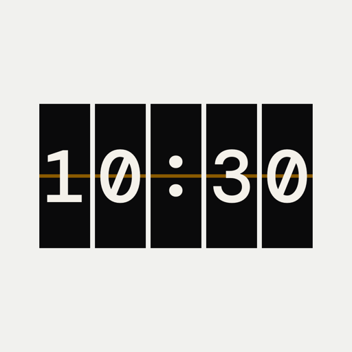
</p>

<h1 align="center">Calendar</h1>

<p align="center">
  A home-server hub and a native iPhone app that give you a calendar of your own.<br>
  Your calendars stay on your server; the phone talks only to it.
</p>

<p align="center">
  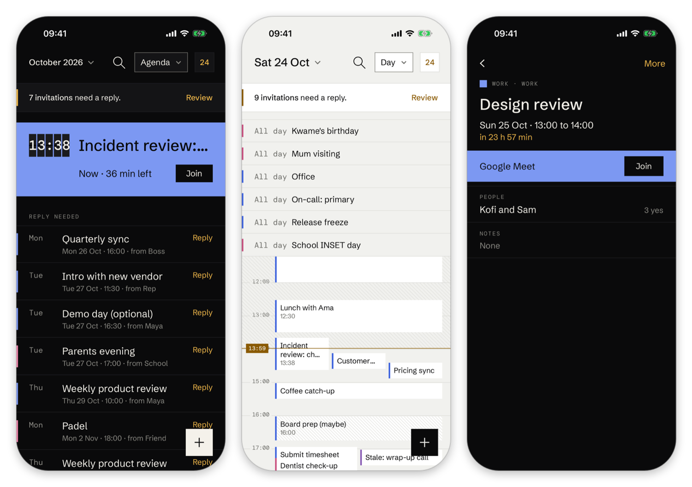
</p>

> **Status:** v0.1.0. Run end to end on a real Google account, over Tailscale, on a physical iPhone. A few paths are
> still unwalked; see [Limitations](#limitations).

## What it is

- **The hub (`calendard`)** is a small Go service you run on a home server. It signs in to your calendar accounts,
  keeps one synced copy in SQLite, and writes your changes back to the provider. Provider tokens never leave it.
- **The app** is a native SwiftUI app (iOS 26) that reads and edits that copy over a token API, with widgets,
  notifications and a Live Activity.
- **Scripts and agents** use the same API with their own tokens, and an MCP endpoint.

## Screenshots

Taken from the real app against a throwaway hub with demo data (`scripts/screenshots.sh`). The capture clock was
Saturday 24 October, about 13:40; the status bar is set to 9:41.

<table>
  <tr>
    <td align="center">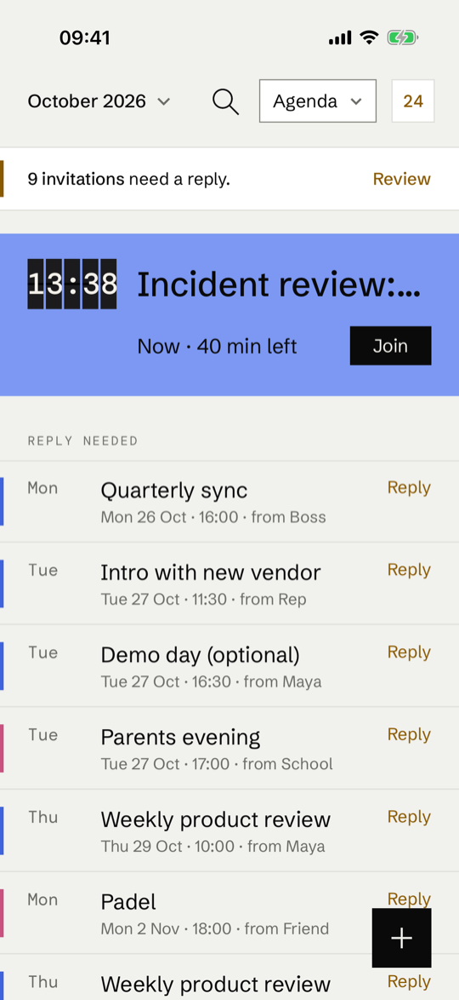<br>Home</td>
    <td align="center">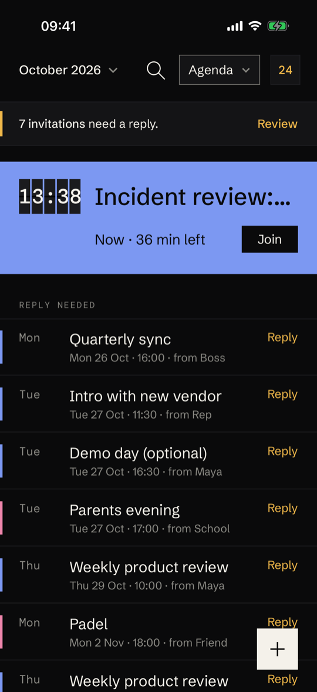<br>Home, dark</td>
    <td align="center">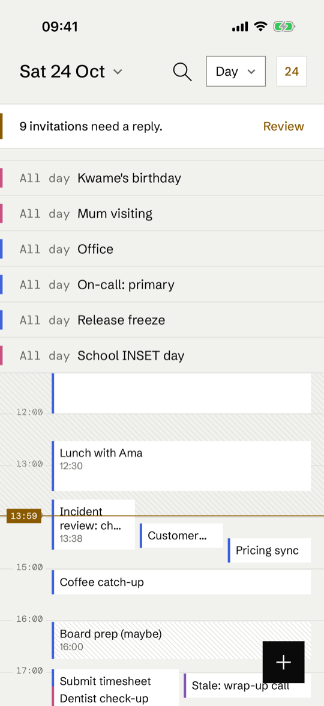<br>Day</td>
    <td align="center">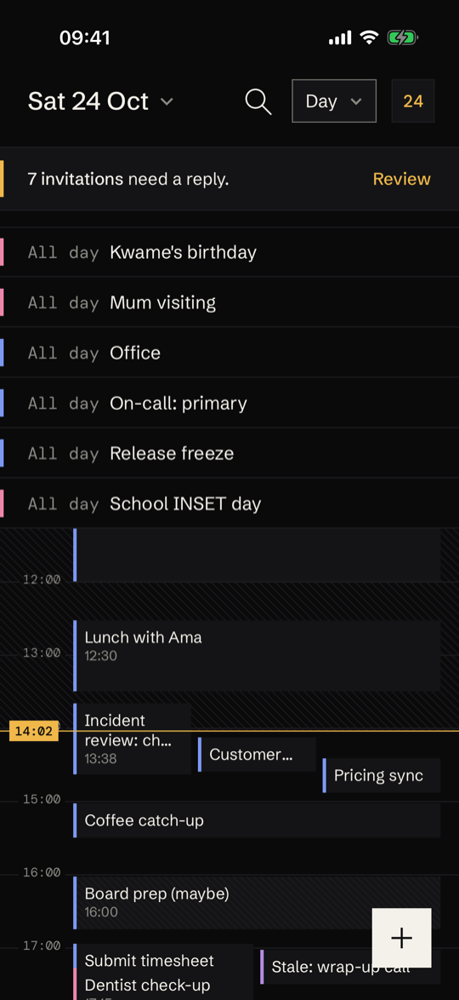<br>Day, dark</td>
  </tr>
  <tr>
    <td align="center">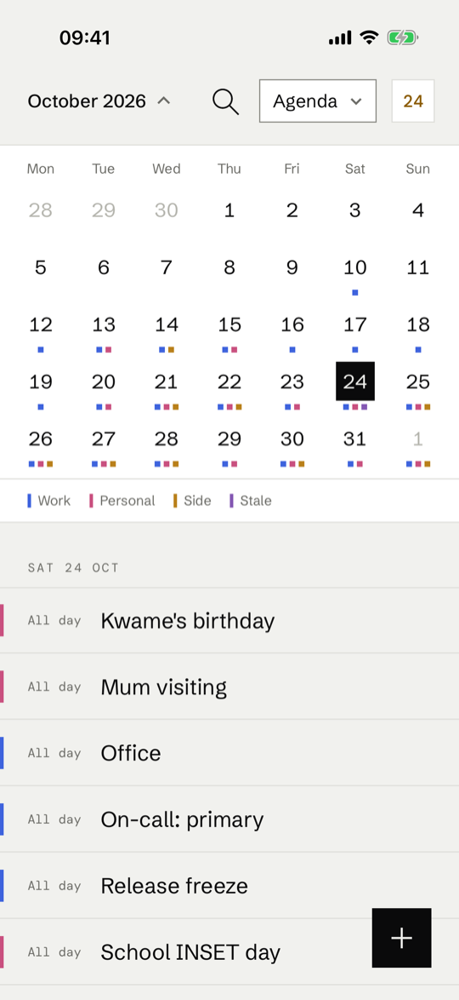<br>Month</td>
    <td align="center">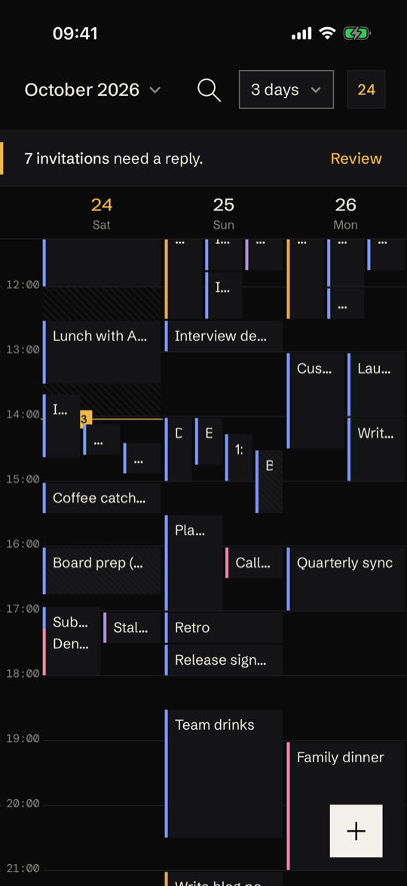<br>3 days, dark</td>
    <td align="center">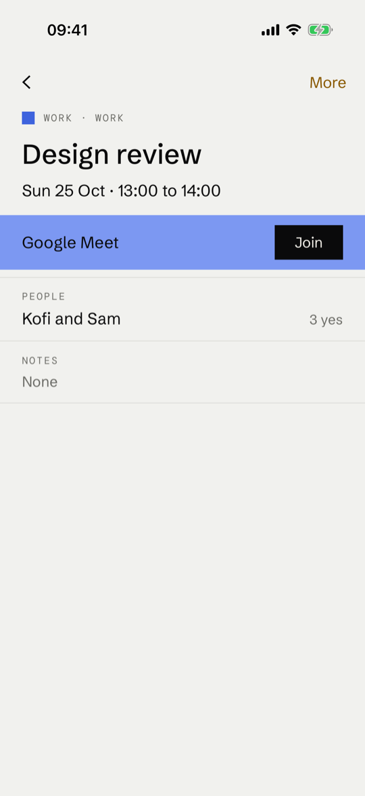<br>Event</td>
    <td align="center">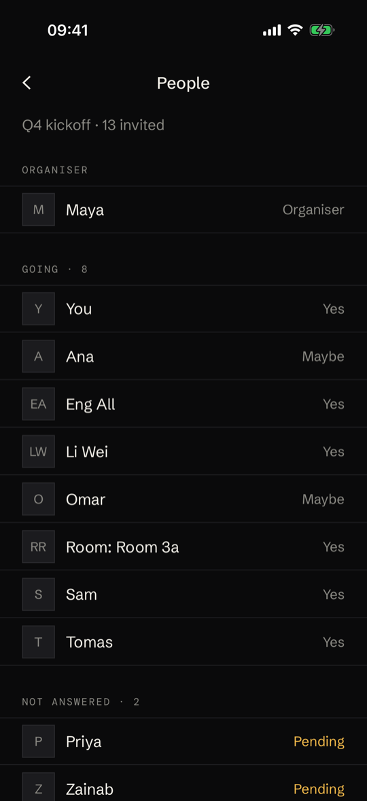<br>Guests, dark</td>
  </tr>
  <tr>
    <td align="center">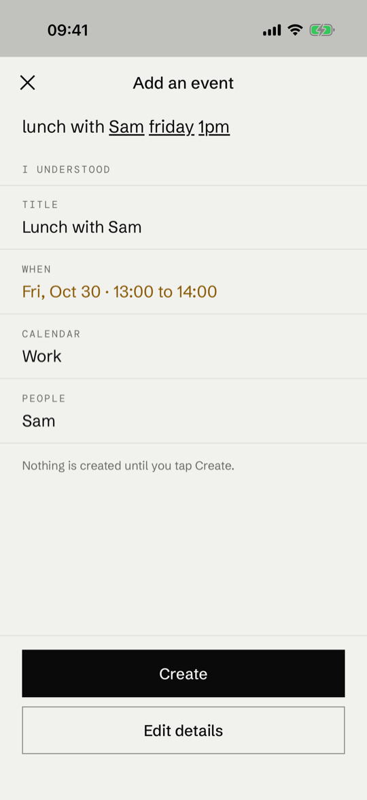<br>Quick add</td>
    <td align="center">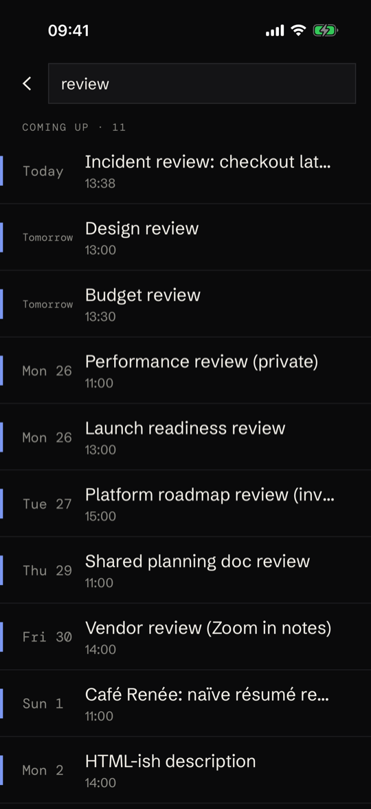<br>Search, dark</td>
    <td align="center">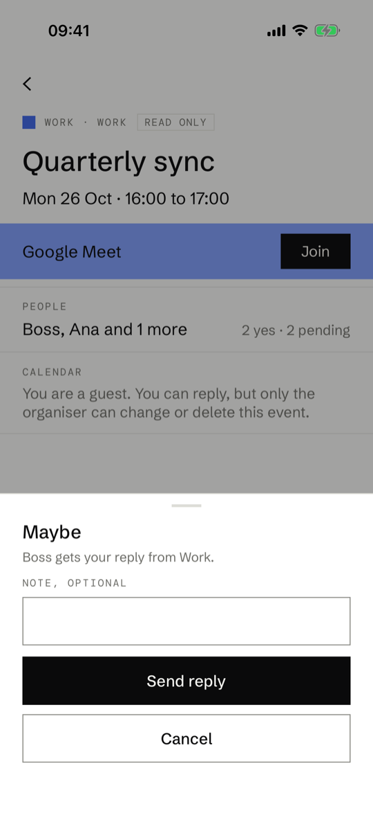<br>Reply</td>
    <td align="center">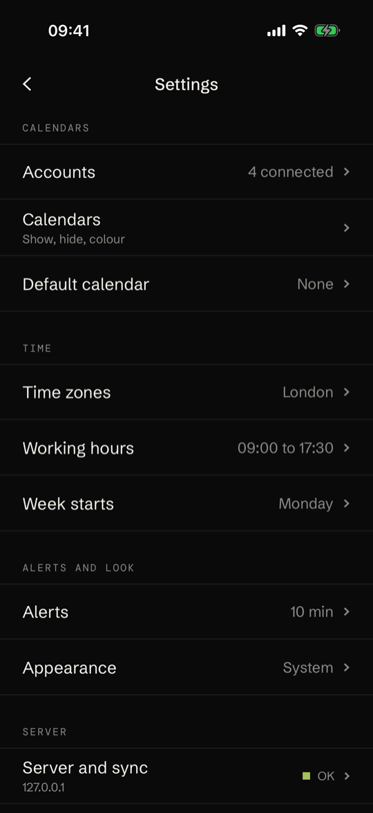<br>Settings, dark</td>
  </tr>
</table>

Every screen in light and dark is in [docs/assets/screenshots](docs/assets/screenshots). Widgets and notifications
are design mocks, not device captures: [docs/assets/design](docs/assets/design).

## Features

- Google Calendar accounts, read and write: create, edit, delete with Undo, move between calendars, RSVP, guests, Meet
  links, all-day and recurring events (including single-occurrence edits), with idempotency keys and conflict
  handling. ICS links, read only.
- Agenda, Day and 3-day views, month picker, free time search, full-text search.
- Quick add from text with a rule-based parser (an alfather adapter exists; its real tool names are unconfirmed).
- Offline reading from the saved copy, with clear banners when the hub or the phone is offline.
- Push through APNs: a silent wake keeps the app current, and alerts for moved, cancelled and new-invitation events
  are worded on the phone, so event titles never travel through Apple. Widgets, a Live Activity and App Intents.
- Token API with read/write/admin scopes, an MCP endpoint, encrypted verified backups, and OpenTelemetry export
  (off unless `OTEL_EXPORTER_OTLP_ENDPOINT` is set; see [observability](docs/engineering/observability.md)).

## Architecture

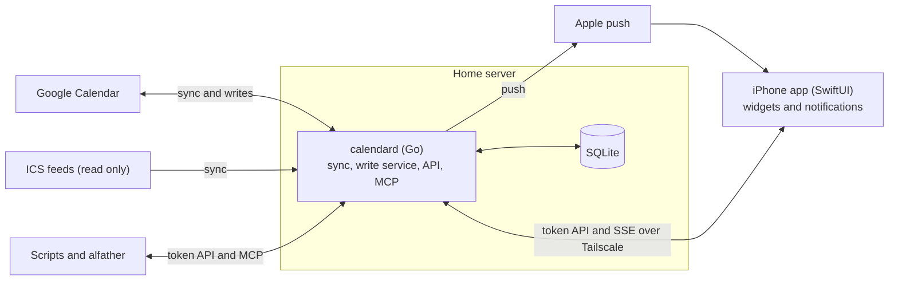

A change made in the app takes the write path, and every client learns about it through the revision stream:

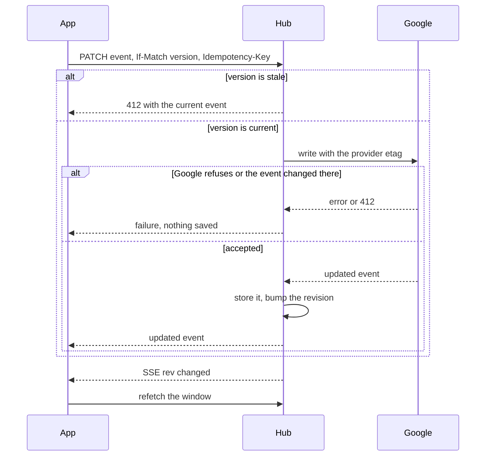

More diagrams (components, sync workers, pairing, read path): [docs/engineering/ENGINEERING.md](docs/engineering/ENGINEERING.md).

## Repository layout

| Path | What |
|---|---|
| `server/` | Go hub `calendard` and the fake Google `fakegoogle` (module `calendar/server`) |
| `api/openapi.yaml` | The wire contract between hub and app |
| `ios/` | Xcode project (generated from `ios/project.yml`), app, widgets, notification extension, Swift packages |
| `deploy/` | Compose files, env example, first-run and verify scripts |
| `scripts/` | Local run and demo, end-to-end, screenshots, release and iOS archive scripts |
| `docs/` | All documentation, indexed in [docs/README.md](docs/README.md) |
| `VERSION`, `Makefile` | Product version (read by the release flow), common tasks |

## Quick start (demo, no Google needed)

```sh
scripts/run-local.sh demo              # the real hub against a fake Google with rich demo data, in .local/demo/
scripts/run-local.sh token             # in a second terminal: prints a device token once
scripts/run-local.sh scenario list     # sync states you can trigger (reauth, google-down, outside-move, ...)
```

Build the app (Xcode 26.6, XcodeGen, an iPhone simulator) with `make ios-gen && make ios-build`, open it, and pair
with the hub address and the `cal_...` token from the first screen. On a real phone the hub must be reachable, for
example over Tailscale (`CALENDAR_ADDR=<tailscale ip>:8790 scripts/run-local.sh demo`). Details and a manual test
checklist: [docs/ops/local-run.md](docs/ops/local-run.md) and [docs/ops/demo-data.md](docs/ops/demo-data.md).

## Deploy with Docker

Each release publishes a multi-arch image, `ghcr.io/sunday-studio/calendar-hub:<version>`, and a GitHub Release with
a deploy bundle. The hub is meant to sit behind HTTPS on your tailnet; nothing is exposed to the public internet.

- Everything as environment values, no secret files: [docs/ops/compose-example.md](docs/ops/compose-example.md)
  (compose file, every variable and its default, telemetry included).
- Mac mini with secret files and a build from source: [docs/ops/first-run.md](docs/ops/first-run.md).
- Files and variables: [docs/ops/deploy.md](docs/ops/deploy.md). Backups, restore, rollback and other day-two
  tasks: [docs/ops/RUNBOOK.md](docs/ops/RUNBOOK.md).

## Testing

```sh
make test              # go vet and go test -race for the hub
make e2e-server        # the hub against the fake Google
make ios-test          # Swift package and app unit tests on a simulator
make ios-e2e-real      # XCUITest against the real hub and the fake Google
scripts/screenshots.sh # regenerate the README screenshots
```

How the end-to-end layers fit together: [docs/engineering/e2e.md](docs/engineering/e2e.md).

## Documentation

Start at [docs/README.md](docs/README.md). Good entry points: [STATUS](docs/process/STATUS.md),
[CHANGELOG](docs/process/CHANGELOG.md), [ENGINEERING](docs/engineering/ENGINEERING.md),
[DECISIONS](docs/process/DECISIONS.md) (including what only the owner can do), [RELEASING](docs/ops/RELEASING.md).

## Limitations

- Not yet walked on a real account: offline save, the "changed elsewhere" conflict, drag and resize, revoking access,
  and moving events between calendars ([docs/ops/SMOKE.md](docs/ops/SMOKE.md)).
- Google answers `fullSyncRequired` to the stored sync token for some calendars, so those resync fully on every poll.
  Correct, but wasteful.
- With the app closed, widgets update only when iOS lets a silent push or background refresh through.
- Only Google and ICS providers exist. The welcome screen still mentions Outlook and iCloud (DECISIONS Q6).
- CI is switched off; the workflows in `.github/` have known failures listed in [docs/ops/ci.md](docs/ops/ci.md).
- No license has been set; all rights are reserved until one is chosen.

## Contributing

This repository is developed with several coding agents working in parallel. Read [AGENTS.md](AGENTS.md) and
[docs/process/COORDINATION.md](docs/process/COORDINATION.md) before changing anything: each worker owns a set of
files and returns one short report.
