# Calendar — Milestone Plan

_2026-10-11 · derived from [ENGINEERING.md](../engineering/ENGINEERING.md); stories from [PLAN.md](PLAN.md); screens from [design notes](../design/README.md)_

The app is called **Calendar**. This doc is the working plan: build in this order, ship each milestone as something you can use or demo.

## Decisions now locked (override ENGINEERING.md where they differ)

| Topic | Decision | Effect on the plan |
|---|---|---|
| Name | **Calendar** (design working name "Gnomon" is retired; rename wordmark/strings in the design set) | URL scheme `calendar://`; hub binary `calendard`; tailnet host `calendar.<tailnet>.ts.net`. Note: Apple's own app is also "Calendar", so give the bundle display name a distinct home-screen label if the clash bothers you |
| Min OS | **iOS 27** | No availability checks; use the newest SwiftUI, WidgetKit, ActivityKit, App Intents APIs freely |
| Apple Developer Program | **Enrolled** | APNs key, App Groups, TestFlight available from day 1 |
| Offline writes | **Not needed** | Offline is read-only forever. Outbox/queue is dropped (not just deferred); edits are disabled offline as in design Y2 |
| alfather | **Later** | Quick add uses the deterministic rule parser first; MCP in/out becomes its own late milestone (M8) behind the same `Parser` interface |
| Accounts | **Several Google accounts** | Google is the only provider for v1. Microsoft, iCloud and ICS move to optional M9. Fewer sign-in screens and edge cases up front |
| Platform | iPhone only | Android untouched |

**Open and small:** are any of the Google accounts **Workspace** (work/school) rather than plain Gmail? Workspace admins can block unverified apps; M0's spike S1 tests one of each so you find out in week 1.

## Roadmap

```mermaid
gantt
  title Calendar — build order (working days, one developer)
  dateFormat  X
  axisFormat  %s
  section Foundations
  M0 Foundations            :m0, 0, 7
  section Core
  M1 Connect Google         :m1, after m0, 8
  M2 Sync                   :m2, after m1, 9
  M3 Read MVP  (use daily)  :crit, m3, after m2, 14
  section Use
  M4 Act on events          :m4, after m3, 12
  M5 Glanceable             :m5, after m4, 14
  M6 Automate               :m6, after m5, 9
  M7 Cut over               :crit, m7, after m6, 5
  section Later
  M8 alfather               :m8, after m7, 5
  M9 Other providers        :m9, after m8, 12
```

Total to cut-over: **~78 working days**. First daily-usable version (M3) lands around **day 38**. Server and app tracks run in parallel after M0 using a fixture hub, so these are sequential only in what you *ship*, not in what you can work on.

## Milestone overview

| # | Milestone | You can… | Days | Stories |
|---|---|---|---|---|
| M0 | Foundations | open the app and see the hub answer over HTTPS | 7 | E0, 0.5 |
| M1 | Connect Google | sign in to your Google accounts from the app | 8 | E1 (Google), 1.5 |
| M2 | Sync | edit in Google web and see it in the hub's API within 2 min | 9 | E2 |
| M3 | Read MVP | **use it daily as your glance calendar** | 14 | E3, E4 |
| M4 | Act | create, edit, move, delete, RSVP, add Meet from the app | 12 | E5 |
| M5 | Glanceable | widgets, reminders, week view with drag & drop | 14 | E6 |
| M6 | Automate | API tokens, free-time, quick add, search, Shortcuts, automations | 9 | E7 (no alfather) |
| M7 | Cut over | stop using Notion Calendar | 5 | E8 |
| M8 | alfather | type or speak natural language; agents use your calendar | 5 | 7.3, 7.6 |
| M9 | Other providers | add Microsoft, iCloud, ICS (only if you need them) | 12 | 1.3, 1.4, 1.6 |

---

## M0 · Foundations — _7 days_

**Goal:** the plumbing exists and a throwaway build of the app can talk to the hub.

**Spikes (do first, ~4 days, throwaway code)**
- [ ] **S1** Google OAuth with a `ts.net` redirect from `ASWebAuthenticationSession`, with one Gmail and one Workspace account if you have both. Refresh token stored.
- [ ] **S2** SwiftUI time grid with ~150 blocks plus long-press drag and resize on a real device at 60+ fps. If it fails, the grid becomes UIKit-backed (decide now, not in M5).
- [ ] **S3** `rrule-go` expansion vs Google's own expansion for ~20 real series across a DST change.
- [ ] **S5** Notification service extension can reach the hub over the tailnet and rewrite a notification.

**Server**
- [ ] Repo skeleton from ENGINEERING §2; `Makefile`; CI (`go test -race`, lint, `sqlc diff`, OpenAPI breaking-change check)
- [ ] Docker Compose: Tailscale sidecar + `calendard`; `tailscale serve` HTTPS; restart policy; `/health`
- [ ] Google Cloud project, Calendar API enabled, consent screen **External → In production**, Web client with `https://calendar.<tailnet>.ts.net/auth/google/callback`
- [ ] Config + Docker secrets; vault (XChaCha20-Poly1305); refuse start without master key
- [ ] Migration `0001_init.sql`; writer/reader pools; `meta.rev`
- [ ] Device tokens: `calendard token create`, hashed storage, middleware, scopes
- [ ] `GET /v1/hello`; first cut of `api/openapi.yaml` locked for M1–M3 endpoints

**iOS**
- [ ] Xcode project (iOS 27), local packages `CalendarCore`, `CalendarUI`, features; App Group; Keychain access group
- [ ] Generated OpenAPI client wired to a `URLSession` transport
- [ ] Design tokens → `Tokens.swift`; Newsreader / Schibsted Grotesk / DM Mono bundled
- [ ] Fixture hub: `calendard serve --fixtures` returns canned agenda/accounts so UI work never waits on sync

**Exit criteria**
- From the phone over Tailscale, the app shows server name/version from `/v1/hello`; off-tailnet it fails cleanly.
- Hub refuses to start without the master key; secrets never in git.
- S1–S3, S5 each have a written result (pass / fallback chosen).

**Depends on:** nothing. **Biggest risk:** S1 (Workspace block) — if it fails, those accounts get the M9 ICS-style fallback or a request to the admin.

---

## M1 · Connect Google — _8 days_

**Goal:** add, list, reconnect and remove Google accounts from the app.

**Server**
- [ ] `POST /v1/accounts/connect`, OAuth session table, PKCE, `/auth/google/callback`, redirect to `calendar://connected`
- [ ] Upsert on `(provider, external_id)` so re-adding never duplicates; multiple Google accounts supported
- [ ] Account palette assignment (cobalt, rose, ochre, mauve, verdigris, slate, moss, clay)
- [ ] Account status machine (`connecting → ok → needs_reauth → …`); `GET/PATCH/DELETE /v1/accounts`, `POST /…/reconnect`; delete cascades secrets + mirror
- [ ] Revoked/expired refresh token detected → `needs_reauth`

**iOS (design: P1–P5, A1–A5, A10–A14)**
- [ ] Pair screen: address + token, 4-step check, failure checklist, success (Keychain save)
- [ ] Add account sheet → system auth sheet → Connecting → Choose calendars + colour
- [ ] Accounts list, detail, Sign in again, Remove with consequences text, Reconnected toast
- [ ] "Needs sign in" amber banner component (reused on Home in M3)

**Exit criteria**
- Three Google accounts connected from the phone; each shows email, colour, status.
- Connecting the same account twice updates instead of duplicating.
- Revoking access in Google's security page flips the row to *Sign in needed*; Reconnect fixes it.
- Remove deletes tokens and data (verify in DB).

**Depends on:** M0. **Stories:** 1.1, 1.2, 1.5, 0.5.

---

## M2 · Sync — _9 days_

**Goal:** every calendar and event from every connected account is mirrored and stays fresh. No new UI needed; verify with the API and the fixture-free test client.

**Server**
- [ ] `provider/google`: `calendarList` (+ sync token), `events.list` with `singleEvents=false`, paging, `syncToken`, `410 → full resync`
- [ ] Shared `httpx` transport: retry, `Retry-After`, jittered backoff, typed errors
- [ ] Upsert pipeline: events, attendees, conferences (structured + parsed links), self RSVP, capabilities (`canEdit/canRSVP/canAddConference`)
- [ ] `recur.Materialiser`: expand masters in the event timezone, apply EXDATE, overlay exceptions, window `[−30d, +400d]`, daily extender job
- [ ] Per-account worker, `Trigger` channel, 60 s / 5 min cadence, `POST /v1/sync` singleflight
- [ ] Cursor written in the same transaction as data; `sync_runs`; `GET /v1/status`
- [ ] Rev log + SSE `/v1/stream` (`rev`, `account`, `sync`, `ping`) with `Last-Event-ID`
- [ ] Per-calendar `visible` flag respected by default queries

**Exit criteria**
- Initial sync of all calendars completes (progress visible in `/v1/status`).
- Create, edit and delete an event in Google web → reflected in `GET /v1/agenda` within 2 minutes, deletions included.
- Recurring series incl. an exception and an EXDATE appear correctly across a DST boundary (S3 fixtures as tests).
- Kill the hub mid-sync → restart → no duplicates, no skipped changes.
- One account failing (revoked) doesn't stop the others; backoff visible in `sync_runs`.

**Depends on:** M1. **Stories:** 2.1–2.4. **Biggest risk:** recurrence/timezone correctness — the golden tests are the safety net, don't skip them.

---

## M3 · Read MVP — _14 days_ ★ start using it daily

**Goal:** the app is a good enough glance calendar to replace opening Notion Calendar for looking things up.

**Server**
- [ ] `GET /v1/agenda?from&to` with `ETag` from `rev`; `GET /v1/events/{id}`; `GET /v1/calendars`, `PATCH` (visible, colour override); `GET/PUT /v1/settings` (default calendar, week start, secondary tz, working hours)
- [ ] Payload shaping to the `AgendaItem` contract; sub-200 ms agenda on the real mirror

**iOS (design: B1–B7, month, C1/C2/C5, D1–D4, D10–D11, G1–G9, K1, K3–K6)**
- [ ] GRDB schema in the App Group; repositories; `SyncEngine` (foreground, SSE `rev`, pull-to-refresh)
- [ ] **Home:** Up-next block with Join (≤10 min or in progress), day list with all-day pinned, overlap markers, Done-for-today, Nothing planned, first-load skeleton, pull-to-refresh progress line
- [ ] Month grid inline, Today button
- [ ] **Day view** with hour grid, side-by-side overlaps, brass now-line, hatched past, swipe between days
- [ ] **Event detail:** time + tz, calendar/account, location → Maps, description, people + status, join link, recurrence summary, read-only state
- [ ] **Settings:** calendars list with toggles, per-calendar colour, default calendar, time zones, week start, appearance
- [ ] Offline (read-only): cached data with "last updated", disabled edit controls, server-unreachable screen + diagnostic checklist (Y1, Y3, Y4); server/sync status + log (Y5, Y6)
- [ ] Accessibility pass on Home and Day (labels, Dynamic Type, Reduce Motion)
- [ ] Snapshot tests for every frame in this set (light/dark)

**Exit criteria**
- Launch to visible content from cache in < 0.5 s; fresh data within ~1 s on tailnet.
- Hide a calendar → disappears everywhere; colour override sticks across relaunch and server restart.
- Airplane mode: agenda still shown, clearly labelled stale; edits disabled.
- A week of using it next to Notion Calendar with no missing events (this *is* the acceptance test).

**Depends on:** M2 (or fixture hub for early UI). **Stories:** 3.1–3.5, 4.1–4.3, 5.6.

---

## M4 · Act — _12 days_

**Goal:** you can do everything in the app that you do with events day to day.

**Server**
- [ ] `events` write service: provider-first, mirror-second; per-account lock; `Idempotency-Key` table; `If-Match` versioning; 409/412 conflict path
- [ ] Google adapter: create, patch, delete, move between calendars, RSVP (patch self attendee), Meet via `conferenceData.createRequest`
- [ ] Recurring scopes: *this*, *this and following* (series split), *all*
- [ ] `PUT /v1/events/{id}/reminder` override stored on the hub
- [ ] After-write nudge sync; commit hook publishes `rev`

**iOS (design: D5–D9, E1–E11, R1–R6)**
- [ ] New event sheet (title, calendar, when, repeat, guests, location, notes, reminder, video call); date/time sheet; Saving, Save failed, Discard changes
- [ ] Edit with scope sheet for repeating events; "Changed elsewhere" conflict screen
- [ ] Actions menu: duplicate, move to calendar (cross-account warning), delete with undo, delete-repeating options
- [ ] Invitations list, reply bar, reply with note, sent / failed, repeating-invite handling
- [ ] Optimistic UI with rollback on failure; haptics

**Exit criteria**
- Round trip on each Google account: create → edit → RSVP → add Meet → move → delete, each verified in Google web.
- Double-tapped Save (same Idempotency-Key) creates one event.
- Edit the same event in Google web first → app shows the conflict screen with the latest version.
- Provider error leaves no half-saved state in app or mirror.
- Recurring edit scopes behave correctly for *this*, *following*, *all* (tested on a weekly series with an existing exception).

**Depends on:** M3. **Stories:** 5.1–5.5, 5.7, 6.2 (override only). **Biggest risk:** "this and following" split — budget extra test time.

---

## M5 · Glanceable — _14 days_

**Goal:** you stop opening the app just to check the time.

**Server**
- [ ] APNs sender (token auth key from secrets), device endpoint registration, dispatcher on commit hook
- [ ] Silent push for changes inside the next 48 h; alert pushes (mutable-content, ids only) for moved/cancelled; needs-reauth push; 07:00 morning-summary push
- [ ] Backup job verified (nightly encrypted SQLite backup + restore drill)

**iOS (design: V1–V8, W1–W7)**
- [ ] **3-day and Week views** reusing the grid; second-time-zone gutter
- [ ] Drag to move + resize, snap 15 min, auto-scroll, optimistic update + rollback animation (S2 outcome decides SwiftUI vs UIKit layout)
- [ ] **Widgets:** small (next event + live countdown), medium (next 3–4); states for empty / sign-in needed; timelines from GRDB
- [ ] **Local notifications** for the next 60 occurrences, per-event overrides, **Join** action
- [ ] **Notification service extension** rewrites alerts via the hub; fallback generic text
- [ ] **Live Activity** for meeting in progress
- [ ] Background refresh + silent-push handler (fetch → GRDB → reschedule → reload widgets)

**Exit criteria**
- Drag an event on a real phone: new time shows instantly, Google updated within seconds; kill the network mid-drag → clean rollback.
- Move an event in Google web → phone gets "moved to …" notification with the right text, without the title ever appearing in the push payload.
- Widget shows the correct next event after a sync with the app closed; countdown ticks.
- Reminder fires 10 min before with a working Join action; survives airplane mode (local).

**Depends on:** M4 (drag needs writes) — widgets/notifications parts can start after M3. **Stories:** 6.1–6.5. **Biggest risk:** time-grid gesture performance (S2).

---

## M6 · Automate — _9 days_

**Goal:** your scripts and the app get more out of the same data. alfather is not needed yet.

**Server**
- [ ] Token admin API (`GET/POST/DELETE /v1/tokens`), read-only script tokens, last-used display
- [ ] `POST /v1/freetime` and `GET /v1/freebusy` from `occurrences` + working hours
- [ ] `POST /v1/quick-add` with the **rule parser** (`Parser` interface; dates, times, durations, "at <place>", calendar hints) returning a Draft with ambiguities
- [ ] FTS5 search: `GET /v1/events?q=`; index maintained in the write transaction
- [ ] Automations: triggers (event start offset, event created, daily cron) → signed webhook / ntfy
- [ ] OpenAPI docs page for scripts; example script in `docs/`

**iOS (design: Q1–Q10 minus AI wording, F1–F3, Y7–Y8)**
- [ ] Quick add: typing → preview → ambiguity choice → created; on-device speech input
- [ ] Find free time → slots → book (no-gap state)
- [ ] Search with results / empty states
- [ ] API tokens list, create (secret shown once), revoke
- [ ] App Intents: Add event, What's next, Join next meeting (Siri/Shortcuts/Action button)
- [ ] Copy changes: where the design says "alfather", say nothing until M8; the "unreachable" state (Q6) is built but dormant

**Exit criteria**
- "lunch with Sam fri 1pm at Kōya" produces a correct draft, you confirm, event lands in the right calendar.
- "When am I free for 2h this week?" returns correct slots that respect working hours and hidden calendars.
- A `curl` with a read-only token reads the agenda but is refused on writes.
- A cron automation posts a daily 07:00 summary to ntfy/webhook.

**Depends on:** M4. **Stories:** 7.1, 7.2, 7.4, 7.5, 3.6 (search).

---

## M7 · Cut over — _5 days_

**Goal:** Notion Calendar is gone.

- [ ] Parity checklist (US-8.1): list what you actually use in Notion Calendar daily; each is *covered* or *consciously dropped*
- [ ] Two weeks of daily use with Notion Calendar closed; log every miss and fix the top ones
- [ ] Hardening: backup restore drill, `govulncheck`, token rotation, log redaction check, upgrade rehearsal
- [ ] Accessibility pass (VoiceOver over Home, Day, Event, Create), Dynamic Type max, Reduce Motion
- [ ] TestFlight build installed on your phone (no 7-day expiry)
- [ ] Revoke Notion Calendar's access in each Google account (Security → Third-party access); uninstall the app (US-8.2)
- [ ] Short runbook: reconnect an account, restore from backup, rotate master key and tokens, renew nothing (no Microsoft secret to track yet)

**Exit criteria:** parity checklist green; Notion Calendar uninstalled and revoked; one successful restore from backup.

---

## M8 · alfather — _5 days (when it's ready)_

**Prerequisite:** you can tell me alfather's MCP tool names/inputs and whether the hub can reach it on the tailnet.

- [ ] `alfather` adapter implementing `Parser` (MCP client); automatic fallback to the rule parser on timeout (3 s) with the Q6 banner
- [ ] Natural-language → free-time params; the server still computes slots
- [ ] Hub MCP server `/mcp`: `agenda`, `get_event`, `search`, `freetime`, `draft_event`, `create_event` (needs a `confirm_token` from a draft), `update_event`, `delete_event`, `rsvp`
- [ ] Default agent token is read-only; mutating tools require a human-approved confirmation in the app
- [ ] Copy and states in the app for alfather-assisted flows turned on

**Exit criteria:** alfather can answer "what does my Thursday look like?" and propose (not silently create) an event that you approve in the app; killing alfather degrades to the rule parser with no errors.

---

## M9 · Other providers — _~12 days, only if needed_

Each is independent; do them in the order you need them.

| Provider | Days | Includes | Notes |
|---|---|---|---|
| **ICS feed** (read-only) | 2 | A7, polling with conditional GET | Best fallback for a Workspace account whose admin blocks the app |
| **iCloud** | 5 | A8–A9, CalDAV discovery, `sync-collection`/ctag, iCalendar write, RSVP read-only | Spike S4 first |
| **Microsoft** | 5 | Entra app, OAuth, Graph delta with rolling window, Windows→IANA tz map, RSVP, Teams link | Needs a client secret whose expiry is tracked in `/v1/status` |

The provider interface and capability flags already exist, so each adds one package and a few screens.

---

## Cross-cutting rules (apply to every milestone)

- **Definition of done:** feature works on a real phone against a real account; tests (unit + integration + snapshot where UI) added; OpenAPI updated; no new warnings; accessibility labels present.
- **Contract first:** change `api/openapi.yaml` → regenerate → implement. Additive only within `v1`.
- **Provider first, mirror second** for every write.
- **No secrets in git, no event titles in logs at info level, no event text in push payloads.**
- **Demo habit:** at the end of every milestone record a 60-second screen capture; it doubles as the regression reference.
- **Scope valve:** if a milestone slips, cut from the *end* of its list (polish, extra states) — never the exit criteria.

## Immediate next steps (this week)

1. Create the monorepo skeleton and CI (M0).
2. Register the Google Cloud project and OAuth client; set consent to **In production**.
3. Run spike **S1** with one Gmail and one Workspace account (if any).
4. Rename Gnomon → Calendar in the design set (strings, wordmark, URL scheme) so screens and code agree.
5. Tell me about the Workspace question above and I'll adjust M1 accordingly.
